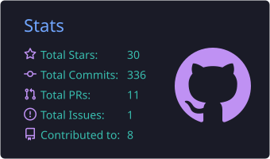
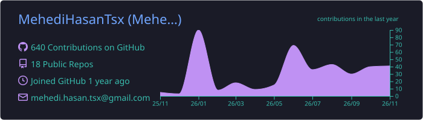
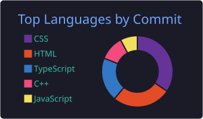
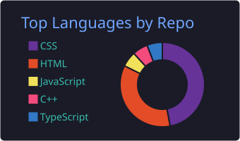
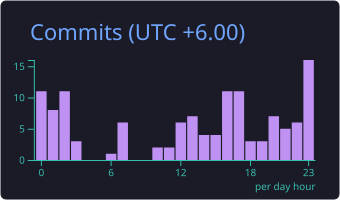

  

  
  
  
  

---

## 👨‍💻 About Me

- 🌐 **Webflow Developer & CMS Specialist** at COZMIQ, building responsive, CMS-driven websites
- 🎓 **Computer Science & Engineering student** from Bangladesh
- 🛍️ Experienced with **WordPress, Shopify, and Wix**, including eCommerce builds and on-page SEO
- ⚛️ Growing into **full-stack development** with React, Next.js, TypeScript, and Node.js
- 🤖 Exploring **AI-powered development**
- 🌱 Big believer in **learning by building** real projects instead of relying only on tutorials

---

## 💼 Experience

### Webflow Developer & CMS Specialist — COZMIQ

- Build and customize **Webflow** websites with responsive layouts
- Structure and manage **CMS** content, collections, and dynamic pages
- Deliver client sites on **WordPress (Elementor)**, **Wix**, and **Shopify**, including eCommerce development and customization
- Handle client revisions, ongoing updates, and website optimization
- Apply **on-page SEO** best practices across projects

---

## 🎓 Education

**Professional Honours in Computer Science & Engineering**
Dhaka City College · National University, Bangladesh · 25th Batch 
---

## 🛠️ Tech Stack

**Languages**

  

**Frontend & Frameworks**

  

**Backend, Data & Runtime**

  

**CMS & Website Platforms**

  
  
  
  
  

Also: Elementor · Wix · Shopify · On-Page SEO

**Tools**

  

---

## 🌱 Currently Exploring

- React and Next.js architecture
- Backend and database design
- AI integration and AI-assisted development
- Strengthening computer science fundamentals and problem solving

---

## 📊 GitHub Stats

  
  

### 💻 Languages I Use

  
  

### ⏰ When I Code

  

---

## 🐍 Contribution Snake

  <picture>
    <source media="(prefers-color-scheme: dark)" srcset="https://raw.githubusercontent.com/MehediHasanTsx/MehediHasanTsx/output/github-snake-dark.svg" />
    <source media="(prefers-color-scheme: light)" srcset="https://raw.githubusercontent.com/MehediHasanTsx/MehediHasanTsx/output/github-snake.svg" />
    
  </picture>

---

## 🤝 Let's Connect

I'm always happy to talk about web development, Webflow, and building useful things. Reach out through any of the links above.

  <em>"Small steps. Big dreams."</em>

